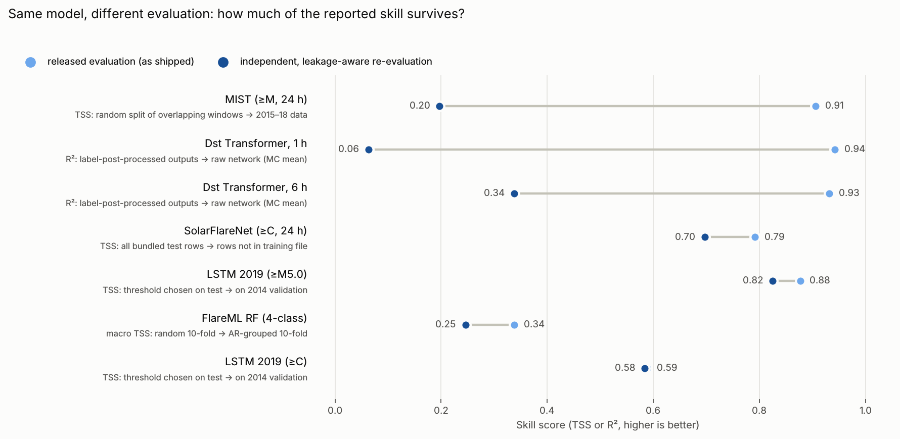

# Reproducing the NJIT CCSC Deep-Learning Tools: Methods, Results and Lessons for Reliable Scientific ML

**Author:** Xiangsheng (Harry) Bao (Master of Data Science candidate, University of Sydney)
**Date:** 13 October 2026
**Scope:** the 19 tools listed on <https://nature.njit.edu/solardb/ccsc> (verified against the live page), each at the
software version its **Citation** button points to, plus the related SolarDB tool MagNet.
**Repository:** every number below is produced by a script in `scripts/` and logged in `results/`.

---

## 1. Executive Summary

**What was asked.** "For each tool, click the Citation button, download the tool to reproduce all results and let me know how the tool works."

**What was done.**
* **Citation buttons.** I followed all 19 Citation buttons on the CCSC page and the one on the CCDC page. Each button opens a Zenodo record. Zenodo first timed out (HTTP 504) from the environment, so each DOI was resolved through DataCite, the registry Zenodo deposits to. Zenodo later became reachable, and the archives were then checked directly.
  * For 13 tools the cited record is a GitHub release tag (e.g. LSTM-flare v1.0.2, SYMHnet v1.0). I ran or diffed **that** version.
  * For 6 tools the record is a direct Zenodo upload. I compared each archive's contents file by file with the GitHub version that was run (§3.5). Four match in content; MIST's archived `test.py` fails as cited (fixed on GitHub); SolarCNN's record is restricted-access.
* **Runs.** I built four isolated Python environments on a 4-core CPU machine without a GPU. For each tool I ran the authors' released test/prediction path with the authors' pretrained models, and compared the outputs with:
  1. the authors' stored outputs;
  2. the **published papers' tables** (16 full texts: 14 from arXiv, plus *Scientific Reports* and *Frontiers*).
* **Independent checks.** Where a released evaluation looked questionable, I added leakage-aware checks: chronological hold-outs, grouped splits, persistence baselines and label-free evaluation.

**Status overview.** "Tool level" means that the released model and data reproduce the authors' stored outputs. "Paper level" means that a headline number of the paper is reproduced.

| Status | Tools |
|---|---|
| **Successfully reproduced** (tool level **and** paper headline) | **SINet** (F10.7 RMSE 3.88 / 16.32 sfu at 1 / 60 d = paper), **DeepGeoCME** (TSS 0.757 = paper) |
| **Successfully reproduced at tool level; the paper's own evaluation cannot be run from the release** | SEP-prediction (12/12 stored rows exact; the paper's numbers are cross-validation means over data and folds not shipped), **SDNN** (all 5 maps match, r = 1.000000; the paper's Milne–Eddington reference maps are not shipped), **FibrilNet** (masks agree with the stored ones exactly as well as two of our own MC-dropout runs agree with each other; the paper's reference skeletons are not shipped), SolarUnet (masks byte-identical; the paper's statistics use 147 frames, only 3 are shipped), Kp-prediction (within MC noise; paper behind a paywall) |
| **Partially reproduced** | **SolarCNN**: stored predictions reproduced to 3 × 10⁻⁵ G. With the training normalisation the shipped `test.py` omits, SSIM rises from 0.812 to 0.892 (paper: 0.833 to 0.904), but only on the 3 shipped samples of the paper's 76. LSTM-flare-prediction, RNN-CME-prediction, SolarFlareNet, SYMHnet, MIST, FlareML, TSInet and CMETNet: the tool's stored outputs are reproduced, but the paper's numbers are not reached, or the released evaluation differs from the paper's (§5, §6). |
| **Attempted but unsuccessful** | Dst-prediction: the stored outputs are reproduced, but the released `predict()` substitutes 0.9 × the true label for most predictions. The raw model's R² (0.06–0.38) is far below the paper's (≈ 0.6–0.75, read off its Figure 3). |
| **Blocked by missing data or compute** | DeepHMI (1,000-step diffusion ≈ 37 CPU-hours; the authors' output was re-scored instead). MagNet (the package on nature.njit.edu lacks `layers/attention.py`, which its model file imports). |
| **Not attempted** | LLMFlare: needs gated Llama-3.1-8B weights, a paid Gemini API key and a GPU. I did not incur costs without authorisation. |

**Key insights for reliable scientific ML.**
1. **Validation design dominates.**
   * The pretrained MIST transformer reaches TSS 0.906 on its released random split of overlapping 24-hour windows. Checked against the authors' own training array (in the Zenodo archive), 95.8 % of test windows share 23 of their 24 hours with a training window.
   * On chronologically and active-region-independent 2015–2018 data it reaches **TSS 0.197** (AUC 0.997 → 0.833).
   * On that same independent test set, the 2019 ≥M LSTM retrained on its published split reaches TSS 0.73–0.75.
2. **The 2019 LSTM data split is exemplary.** It is chronological (2010–13 / 2014 / 2015–18) with zero shared active regions. Using it, I measured how much choosing the decision threshold on the test set inflates TSS:
   * relative to choosing it on the 2014 validation year: +0.005 (≥C), +0.009 (≥M), +0.052 (≥M5.0);
   * relative to the tool's fixed threshold: +0.009, +0.018, +0.143.
   Rare classes are the most sensitive.
3. **Released models and data do not always match the paper.**
   * RNN-CME: the released pretrained models score TSS 0.26–0.49 on the paper's own test set, against 0.45–0.60 in its Table 4. The two copies of the data in the release also store the 18 SHARP columns in **different orders**, and the code's feature ranking matches the paper's Table 2 only under the physically implausible one.
   * SolarFlareNet: 8 of the 9 shipped models have no skill on the bundled test data (paper TSS 0.71–0.84).
4. **Several released evaluation paths do not measure what they appear to measure.**
   * Dst: label-dependent post-processing.
   * SYMHnet: identical 1 h and 2 h data with a next-row target. The cited v1.0 code reproduces the paper's per-storm RMSE for 3 of 7 test storms (within ~2 %), so the paper's numbers appear to come from this pipeline.
   * CMETNet: best-of-10 model chosen on the test year.
   * FlareML: display-side metric adjustment and test-batch scaling.
   * SolarCNN `test.py`: omits the training normalisation, so the shipped predictions show no improvement although the model does.

*Figure 1. The same model scored two ways. Light dots: the evaluation as shipped in the repository. Dark dots: an
independent, leakage-aware re-evaluation of the same weights or code. Numbers are in §5; the script is
`scripts/figures/released_vs_independent.py`.*

5. **Scope.** These are observations about the released software at the cited versions. Where a paper's own evaluation data are not in the release, I say so rather than infer anything about the paper. I would value the authors' guidance wherever the release and the paper appear to differ.

---

## 2. Tools and Publications

Each tool's Citation button points to a Zenodo software archive (`papers/citations/README.md` has the full APA/BibTeX records). The papers are listed here.

| # | Tool | Publication | Paper DOI / arXiv | Citation button → Zenodo (version) |
|---|---|---|---|---|
| 1 | SolarUnet | Jiang et al., *Identifying and Tracking Solar Magnetic Flux Elements with Deep Learning*, ApJS 250:5 (2020) | 10.3847/1538-4365/aba4aa; arXiv:2008.12080 | 10.5281/zenodo.5643647 (v.1.2) |
| 2 | FlareML | Abduallah et al., *DeepSun: Machine-Learning-as-a-Service for Solar Flare Prediction*, RAA 21:160 (2021) | 10.1088/1674-4527/21/7/160; arXiv:2009.04238 | 10.5281/zenodo.7506997 (v1.5) |
| 3 | RNN-CME-prediction | Liu, Liu, Wang & Wang, *Predicting CMEs Using SDO/HMI Vector Magnetic Data Products and RNNs*, ApJ 890:12 (2020) | 10.3847/1538-4357/ab6850; arXiv:2002.10953 | 10.5281/zenodo.7415731 (v1.3) |
| 4 | LSTM-flare-prediction | Liu, Liu, Wang & Wang, *Predicting Solar Flares Using a Long Short-term Memory Network*, ApJ 877:121 (2019) | 10.3847/1538-4357/ab1b3c; arXiv:1905.07095 | 10.5281/zenodo.5739321 (v1.0.2) |
| 5 | SEP-prediction | Abduallah et al., *Predicting SEPs Using SDO/HMI Vector Magnetic Data Products and a BiLSTM Network*, ApJS 260:16 (2022) | 10.3847/1538-4365/ac5f56; arXiv:2203.14393 | 10.5281/zenodo.7516609 (v1.4) |
| 6 | Dst-prediction | Abduallah et al., *Forecasting the Disturbance Storm Time Index with Bayesian Deep Learning*, FLAIRS-35 (2022) | 10.32473/flairs.v35i.130564; arXiv:2205.02447 | 10.5281/zenodo.7529705 (v1.1) |
| 7 | TSInet | Abduallah et al., *Reconstruction of Total Solar Irradiance by Deep Learning*, FLAIRS-34 (2021) | 10.32473/flairs.v34i1.128356; arXiv:2107.11042 | 10.5281/zenodo.7516668 (v1.6) |
| 8 | Kp-prediction | Abduallah, Wang, Xu & Wang, *A Transformer-Based Framework for Geomagnetic Activity Prediction*, ISMIS 2022, LNCS 13515 | 10.1007/978-3-031-16564-1_31 | 10.5281/zenodo.7514451 (v1.1) |
| 9 | CMETNet | Alobaid et al., *Predicting CME Arrival Time through Data Integration and Ensemble Learning*, Front. Astron. Space Sci. 9:1013345 (2022) | 10.3389/fspas.2022.1013345 | 10.5281/zenodo.7516684 (v.1.1) |
| 10 | FibrilNet | Jiang et al., *Tracing Hα Fibrils through Bayesian Deep Learning*, ApJS 256:20 (2021) | 10.3847/1538-4365/ac14b7; arXiv:2107.07886 | 10.5281/zenodo.7521568 (v1.6) |
| 11 | SDNN | Jiang et al., *Inferring LOS Velocities and Doppler Widths from Stokes Profiles of GST/NIRIS Using Stacked DNNs*, ApJ 939:66 (2022) | 10.3847/1538-4357/ac927e; arXiv:2210.04122 | 10.5281/zenodo.7521580 (v1.3) |
| 12 | SolarFlareNet | Abduallah, Wang, Wang & Xu, *Operational Prediction of Solar Flares Using a Transformer-Based Framework*, Sci. Rep. 13:13665 (2023) | 10.1038/s41598-023-40884-1 | 10.5281/zenodo.10201356 (tag v1.3) |
| 13 | SYMHnet | Abduallah et al., *Prediction of the SYM-H Index Using a Bayesian Deep Learning Method with UQ*, Space Weather 22, e2023SW003824 (2024) | 10.1029/2023SW003824; arXiv:2402.17196 | 10.5281/zenodo.10602518 (tag v1.0) |
| 14 | SolarCNN | Xu et al., *Super-Resolution of SOHO/MDI Magnetograms … Attention-Aided CNN*, Sol. Phys. 299:36 (2024) | 10.1007/s11207-024-02283-1; arXiv:2403.18302 | 10.5281/zenodo.15250172 (direct upload) |
| 15 | MIST | Software record: Chaudhary, Abduallah & Wang (2025), *A New Deep Learning Method for Solar Flare Prediction*. Closest paper found: Chaudhary, Wang, Xu, Xu & Zhang, *Prediction of Solar Flares Using Photospheric Magnetic Field Parameters with Deep Learning* (2026); its link to MIST is my inference (§5.1) | arXiv:2606.21896 | 10.5281/zenodo.16780646 (direct upload) |
| 16 | DeepHMI | Xu, Xu, Wang, Li & Wang, *Improving the Spatial Resolution of SDO/HMI … Using GST/NIRIS Data*, A&A (2025) | 10.1051/0004-6361/202453581 | 10.5281/zenodo.17059248 (direct upload) |
| 17 | SINet | Wang Z. et al., *Daily Predictions of F10.7 and F30 Solar Indices with Deep Learning*, JGR Space Physics (2026) | 10.1029/2025JA034868; arXiv:2604.10045 | 10.5281/zenodo.20274899 (direct upload) |
| 18 | LLMFlare | Software record: Chaudhary, Abduallah & Wang (2026), *Explainable Solar Flare Prediction Using Large Language Models*. No paper found | — | 10.5281/zenodo.20738748 (direct upload) |
| 19 | DeepGeoCME | Yan, Wang, Wang, Lee, Jing, Xu, Xu & Yurchyshyn, *Deep Learning-Enabled Prediction of Geoeffective CMEs Using SOHO and SDO Observations* (2026) | arXiv:2605.24748 | 10.5281/zenodo.22955090 (direct upload, 1.0.0) |
| – | MagNet (SolarDB, not on the CCSC page) | Jiang et al., Sol. Phys. 298:87 (2023); Yesmanchyk et al., *Out-of-Sample Validation of MagNet* (2026) | 10.1007/s11207-023-02180-z; arXiv:2211.02278; arXiv:2601.15926 | — |

Rows follow the order of the CCSC page. Full 16-field records are in `tool_inventory.md`.

---

## 3. Methodology

**3.1 Identifying the tools and following the Citation buttons.**
* The CCSC page (`nature.njit.edu/solardb/ccsc`) builds its 19 tiles in `js/script.js` from `ccsc_pages/pages_data.json`.
  * Each tile title links to `github.com/ccsc-tools/<repo>`.
  * Each **Citation** button links to a Zenodo record.
  * Both files and an HTML snapshot are saved in `papers/citations/`.
* The 19 tiles are exactly the 19 `ccsc-tools` repositories reproduced here.
* The CCDC page lists one dataset, FlareDB (see `reports/CCDC_Dataset_Analysis.md`).
* On 2026-10-13 `zenodo.org` answered HTTP 504 (gateway time-out). I tried the API, the record pages and `www.zenodo.org`, and the Wayback Machine has no snapshots. Each DOI was therefore resolved through DataCite and doi.org content negotiation (APA, BibTeX and full metadata; `scripts/citations/fetch_ccsc_citations.py`). On 2026-10-14 Zenodo answered normally, and the six direct-upload archives were checked (§3.5).
* On the CCSC page, several DOIs differ from the badges in the GitHub READMEs (e.g. FlareML page 10.5281/zenodo.7506997 vs README 10.5281/zenodo.5634114). I treated the page as authoritative.

**3.2 Reproduction protocol (per tool).**
1. Read the README and notebook and record the citation, data, weights and environment.
2. Make a working copy of the **cited version** (`git archive <tag>` for tagged releases, HEAD for direct uploads; §3.5). The upstream clone is never modified.
3. Create an isolated environment with the closest available versions (§4).
4. Run the **released** test/prediction entry point with the **released** weights and data, and log stdout.
5. Compare with the authors' stored outputs (result CSVs, logs, notebook outputs).
6. Compare with the **paper's tables**: on the paper's own test set where the release ships it, otherwise with the closest comparable quantity, stating the difference.
7. Audit the evaluation: data provenance, train/test overlap, threshold and model selection, label use at inference, horizon definition, baselines.
8. Where the released evaluation was not out-of-sample, run an **independent** evaluation that changes only the evaluation, never the model. It is labelled as an extension, not a reproduction.

**3.3 Integrity rules.**
* Nothing is reported that was not executed; every number has a log or JSON.
* "Reproduced" always states its scope (tool level or paper level).
* Compatibility edits are kept minimal and documented in each script's docstring. Examples:
  * `Model(inputs=…)` for Keras 2;
  * keyword arguments for scikit-learn ≥ 1.0;
  * a `torch.load(weights_only)` shim for torch 1.12;
  * a sorted `os.listdir`;
  * `K.tf` → `tf.compat.v1` for FibrilNet;
  * early-bound Lambda closures for SDNN (§5.4).
* Third-party artefacts (FibrilNet/SDNN models and input from web.njit.edu, the SolarCNN model from the README's Google Drive link) were downloaded only from the authors' own links. Their SHA-256 hashes are in `results/downloaded_artefacts_sha256.txt`; they are not redistributed.
* No upstream repository was modified, no paid service was used, and no e-mail was sent.

**3.4 Metrics.**
* Classification: recall, precision, ACC, BACC, HSS and **TSS** (insensitive to class ratio, the standard for flare forecasting), plus AUC.
* Regression: RMSE, MAE, R², Pearson r, and skill relative to **persistence**.
* Images: SSIM, PSNR, PCC, IoU and RMSE (G).
* Definitions are in `scripts/common_metrics.py`.

**3.5 Cited release vs the GitHub HEAD.** `results/cited_versions/cited_tag_vs_HEAD_diffstat.txt` lists `git diff --stat <tag> HEAD` for the 13 tagged tools.
* **Documentation or environment files only:** SolarUnet, FlareML, RNN-CME, SEP, Dst, TSInet, Kp, CMETNet, FibrilNet, SDNN. HEAD results apply to the cited version unchanged; FibrilNet, SDNN and RNN-CME were in any case run from the cited tag.
* **SolarFlareNet v1.3:** a 4-line change in `utils.py` that does not change the features fed or the models.
* **LSTM-flare v1.0.2:** the cited release ships **different (older) demo models**. With them, the stored demo outputs are reproduced:

  | Class | Agreement with stored output | TSS (ours) | TSS (stored) |
  |---|---|---|---|
  | ≥C | 99.5 % | 0.471 | 0.459 |
  | ≥M | 99.1 % | 0.576 | 0.586 |
  | ≥M5.0 (positive column 1) | 99.5 % | 0.707 | 0.700 |

  So the HEAD mismatch reported earlier came from HEAD's newer models. The test script still reads softmax column 0, so ≥M5.0 is inverted as released (TSS −0.679).
* **SYMHnet v1.0:** 11 input features (HEAD has 8) and different weights; the same data and the same next-row target. All 28 runs were repeated at v1.0 (`results/cited_versions/SYMHnet_v1.0/`).
* **Direct Zenodo uploads.** Each zip's central directory was read with HTTP range requests, and every entry's size and CRC-32 was compared with the GitHub file at the same path (`scripts/citations/compare_zenodo_archives.py`; `results/cited_versions/zenodo_records/`):

  | Tool | Result of the archive check |
  |---|---|
  | DeepHMI, SINet | identical content; the differing files differ only in line endings (CRLF vs LF) |
  | LLMFlare | identical (23 files) |
  | DeepGeoCME | identical in substance (HEAD's README adds one sentence linking to Zenodo). The archived model and test tensors have the same size and CRC-32 as the GitHub release assets that were run |
  | MIST | model and data identical. The archived `test.py` lacks `import os` but calls `os.path.join`, so **the cited version fails with `NameError`**; HEAD adds the import. The archive also contains `data/processed/X_train.npy`, which GitHub lacks (used in §5.1) |
  | SolarCNN | the record is **restricted-access**: no public files, so it cannot be checked |

  For these tools, the HEAD results therefore stand for the cited versions, apart from MIST's one-line fix.

---

## 4. Experimental Setup

* **Hardware:** cloud container, 4 vCPU, 15 GB RAM, **no GPU**, ~30 GB writable disk; Linux 6.18.
* **Network:**
  * Reachable at first: GitHub and PyPI.
  * Reachable after the applicant enabled full network access: `nature.njit.edu`, `web.njit.edu`, arXiv, nature.com, frontiersin.org and Google Drive.
  * Zenodo: HTTP 504 on 2026-10-13, reachable on 2026-10-14 (SolarCNN's record is restricted-access).
  * Still unreachable: the AGU/Wiley, A&A and Springer full texts (403 or paywall).
* **Environments** (frozen in `tools/environments/`):
  * `tf210`: Python 3.9.25, TensorFlow 2.10.1 (CPU), Keras 2.10, TFP 0.17, tensorflow-addons 0.19, scikit-learn 1.2.1, xgboost 1.5. Used for the TensorFlow tools (the papers used TF 1.11–2.11).
  * `sk024`: Python 3.9, scikit-learn 0.24.2, sklearn-extensions 0.0.2. Used for FlareML; the pickles were written by scikit-learn 0.23.2.
  * `torch112`: Python 3.9, PyTorch 1.12.1 (CPU), timm 1.0.9. Used for MIST, SINet, DeepHMI and DeepGeoCME (MIST/DeepGeoCME request torch 2.3/≥2.6).
  * `np2`: Python 3.11, NumPy 2.0. Used only to read MIST's scaler pickle.
* **Upstream code:** commit hashes in `tools/upstream_commits.csv`; cited tags in §2.
* **Re-running:** each `results/<tool>/` folder has the logs. Each script in `scripts/<tool>/` documents its usage (run from a working copy of the upstream repository).

---

## 5. Reproduction Results

### 5.1 Flare forecasting

**LSTM-flare-prediction (Liu et al. 2019; cited v1.0.2).**
* *Released demo (cited v1.0.2 models):* the stored outputs are reproduced (99.1–99.5 % agreement; §3.5).
  * For **≥M5.0**, the test script reads softmax column 0 as "positive", but the label encoder orders the classes ['N','X']. The predictions are therefore inverted: TSS −0.679 as released.
  * `results/cited_versions/LSTM-flare-prediction_v1.0.2/`.
* *Paper split (Table 2 of the paper, whose sample counts match the shipped `Table2_dataset` exactly).* Retrained with the released code and unchanged hyper-parameters (7 epochs, batch 256, balanced class weights, the tool's feature subsets of 20 / 22 / 14 features), **10 seeds** each. Test = 2015-01 → 2018-05.

| Class (test n, positives) | Threshold policy | Recall | Precision | BACC | HSS | **TSS** |
|---|---|---|---|---|---|---|
| ≥M5.0 (44,689, 180) | paper's stated 0.50 | 0.886 | 0.048 | 0.906 | 0.084 | 0.812 ± 0.119 |
| | tool's fixed 0.75 | 0.778 | 0.068 | 0.867 | 0.117 | 0.734 ± 0.164 |
| | chosen on 2014 validation | 0.904 | 0.048 | 0.913 | 0.083 | 0.825 ± 0.104 |
| | chosen on test | 0.964 | 0.047 | 0.939 | 0.082 | **0.877 ± 0.035** |
| ≥M (44,689, 1,278) | paper's stated 0.60 = tool's fixed | 0.810 | 0.233 | 0.865 | 0.331 | 0.730 ± 0.031 |
| | validation | 0.864 | 0.173 | 0.869 | 0.251 | 0.739 ± 0.022 |
| | test | 0.846 | 0.206 | 0.874 | 0.298 | **0.748 ± 0.021** |
| ≥C (44,689, 8,732) | paper's stated 0.50 = tool's fixed | 0.722 | 0.555 | 0.790 | 0.521 | 0.580 ± 0.011 |
| | validation | 0.748 | 0.528 | 0.792 | 0.505 | 0.584 ± 0.009 |
| | test | 0.757 | 0.524 | 0.795 | 0.504 | **0.589 ± 0.009** |

  * **Paper Table 3/4 (LSTM, all 40 features, thresholds 0.50 / 0.60 / 0.50): TSS 0.877 / 0.790 / 0.607.** At the paper's thresholds the retrained models give 0.812 / 0.730 / 0.580, which is 0.03–0.07 lower. The feature subsets differ from Table 4 (the tool uses Table 5's best features).
  * Files: `table2_summary.md`, `table2_paper_thresholds.json`.
  * Split audit: train / validation / test HARPs are disjoint (0 shared ARs) and chronological (`table2_split_audit.json`).
* *Paper Table 5 protocol (≥C; 10×10 CV, original `LSTMpredict.py` with a 4-line TF2 patch).* 100 trainings, 86 CPU-minutes:

| Metric | Paper Table 5 = authors' `output.txt` (TF 1.12) | Re-run (TF 2.10) |
|---|---|---|
| Recall | 0.773 (0.027) | 0.741 (0.023) |
| Precision | 0.541 (0.030) | 0.531 (0.024) |
| ACC | 0.826 (0.015) | 0.821 (0.012) |
| BACC | 0.806 (0.004) | 0.790 (0.005) |
| HSS | 0.526 (0.021) | 0.505 (0.018) |
| **TSS** | **0.612 (0.009)** | **0.581 (0.011)** |

  The authors' `output.txt` equals the paper's Table 5 ≥C column digit for digit. The re-run is 0.031 TSS lower. Patching in Keras 2.2.4's `hard_sigmoid` recurrent activation did not change this, so the gap is attributed to framework differences (`table5_comparison.json`).
* *Code notes:* the history-masking check tests `row` instead of `prev_row`, so incomplete history rows are never masked. Table 5 selects the threshold that maximises mean TSS on the test folds.

**MIST (cited: Zenodo 16780646; identical to GitHub HEAD except that the archived `test.py` lacks `import os` and fails with `NameError`; HEAD run).**
* The released `test.py` reproduces **TSS 0.9062** (TP 493, FN 49, FP 56, TN 16,313), matching the README's 0.90.
* *Paper.* The software record's title ("A New Deep Learning Method for Solar Flare Prediction") does not match any paper I could find. The closest is arXiv:2606.21896 (Chaudhary, Wang, Xu, Xu & Zhang 2026). It describes the same design: 16 SHARP features, T = 24, patch length 2, d = 128, May 2010–May 2018 data, and a stratified random train/test split with Optuna thresholds tuned "to maximize the true skill statistic on the test set".
  * Its reported test numbers differ from the released model's on the released split:

    | | Paper (arXiv:2606.21896) | Released model, released split |
    |---|---|---|
    | Train / test windows | 67,661 / 16,916 (553 positives) | 67,642 / 16,911 (542 positives) |
    | Accuracy | 95.18 % | 99.38 % |
    | Recall | 0.89 | 0.910 |
    | AUC | 0.96 | 0.997 |

  * The two are therefore related but not the same experiment.
* *Data provenance:* `processed_solar_dataset.csv` equals the LSTM Table 2 ≥M training file (2010-05 → 2014-01) to within 4.4 × 10⁻¹⁶, with identical labels. Windows are rows *p…p+23* labelled by row *p+24*. The 80/20 split is random over windows, and the scaler is fitted on all 84,577 rows.
* **Overlap.**
  * Reconstructed from the CSV: 16,172 of 16,911 test windows (95.6 %) have an adjacent window, shifted by one hour, in training.
  * **Confirmed with the authors' own training array.** The Zenodo archive contains `X_train.npy` (67,642 windows, matching `y_train`). Compared exactly, 16,195 test windows (**95.8 %**) share 23 of their 24 rows with a training window, and 132 are identical to one. That includes 522 of the 542 positive test windows (96.3 %). File: `results/MIST/train_test_overlap_from_zenodo.json`.
  * The small excess over the reconstruction comes from windows whose rows also recur elsewhere in the data.
* **Out-of-sample check** (same weights and preprocessing):

| Evaluation set | n windows | positives | AUC | TSS @0.5 | TSS @ threshold chosen on 2014 |
|---|---|---|---|---|---|
| Released random-split test | 16,911 | 542 | 0.997 | **0.906** | — |
| 2014 (validation file) | 26,449 | 1,347 | 0.835 | 0.208 | — |
| 2015–2018 (test file) | 44,665 | 1,278 | 0.833 | **0.197** | 0.364 |

  `results/MIST/out_of_sample_eval.json`.

**SolarFlareNet (cited tag v1.3).**
* The 9 shipped checkpoints load completely, and the released tests reproduce the stored result CSVs (≥ 99.98 % agreement for 8/9).
* **Paper (10-fold CV): TSS 0.818 / 0.839 / 0.835 at 24 h (≥M5.0 / ≥M / ≥C); 0.71–0.74 at 48 and 72 h.**
* On the bundled 2022 test files, **8 of the 9 shipped models have no skill** (AUC 0.40–0.53; TSS −0.04 to 0.05), in both our run and the authors' stored files.
* The ninth model (C/24 h) gives TSS 0.792. However, 84 % of the 24 h test rows (same HARP and timestamp) are also in `training_data_*_24.csv`; on the 2,581 rows *not* in training, TSS = 0.697.
* The loader selects features by position, using another dataset's column order, and its `start_feature=5` skips the first feature. The 9 features fed are therefore TOTPOT, ABSNJZH, USFLUX, AREA_ACR, MEANPOT, R_VALUE, MEANGAM, MEANJZH and MEANJZD, rather than the paper's 9 (which include TOTUSJH, TOTUSJZ, MEANALP and SAVNCPP).

**FlareML (cited v1.5).**
* The released pretrained ensemble reproduces the shipped log on the 40-sample demo: ENS accuracy 0.850, RF 0.825, ELM 0.725, MLP 0.300.
* 31 of the 40 demo test rows match training rows on all 13 features.
* Two display-side adjustments exist:
  * `check_pm_precision` replaces RF's displayed score by ENS − U(0.01, 0.07) whenever RF ≥ ENS.
  * `log_cv_report` edits FP/FN cells when they are 0.
* **Paper Table III:** average TSS ENS 0.507, RF 0.488. *Extension* on the 845-flare table (RF, shipped hyper-parameters, 5 seeds):

  | Protocol | Macro-TSS |
  |---|---|
  | Random 10-fold | **0.338 ± 0.007** |
  | AR-grouped 10-fold | **0.246 ± 0.022** |
  | Chronological | 0.363 ± 0.009 |

  The paper's exact protocol is not in the release, so the gap to 0.488 cannot be attributed.

### 5.2 CME and SEP

**RNN-CME-prediction (cited v1.3, run from the tag).**
* *Tool level:* predicted labels are **identical** to the stored outputs for all 10 GRU/LSTM × 12–60 h models on the 2-AR demo (TSS 0.817–1.000).
* *Paper level:* `CME_data_samples/` holds the paper's full test sets; the row counts equal its Table 1 (e.g. 24 h: 922 + 1,059). Scoring the released models on them (`paper_testset_eval.json`):

| Model | n (pos) | AUC | TSS @ tool threshold | TSS @ best threshold | Paper Table 4 TSS / AUC |
|---|---|---|---|---|---|
| GRU 12 h | 1,312 (550) | 0.753 | 0.310 | 0.414 | 0.452 / 0.779 |
| GRU 24 h | 1,981 (922) | 0.767 | 0.382 | 0.452 | 0.588 / 0.850 |
| GRU 36 h | 2,467 (1,214) | 0.741 | 0.486 | 0.518 | 0.602 / 0.874 |
| GRU 48 h | 2,900 (1,540) | 0.719 | 0.351 | 0.372 | 0.588 / 0.822 |
| GRU 60 h | 3,297 (1,814) | 0.731 | 0.471 | 0.480 | 0.600 / 0.870 |
| LSTM 12–60 h | as above | 0.635–0.786 | 0.263–0.372 | 0.369–0.426 | 0.459–0.562 / 0.791–0.858 |

  * The full test files contain no 'padding' rows. On the two demo ARs, building the history without them changes 0–4.4 % of predicted labels, so this does not explain the gap.
  * The paper's numbers are means over 10 CV runs, while these are single released models.
* *Data inconsistency* (`column_label_check.json`). The 18 feature columns in `CMEpredict/normalized_*.csv` (used to train the released models) are the same values as in `CME_data_samples/` but **in a different order**.
  * Under the `CME_data_samples` header, extensive parameters correlate with USFLUX as expected (TOTUSJH 0.92, TOTPOT 0.89, AREA_ACR 0.92).
  * Under the order assumed by `CMEpredict.py`, they do not (TOTPOT 0.06, AREA_ACR −0.11, while "MEANGBT" correlates 0.92).
  * The code's feature-index lists reproduce the paper's Table 2 ranking exactly under the second naming. For example, the GRU 24 h model's "MEANPOT, SHRGT45, MEANJZH, …" are, by the physically consistent naming, ABSNJZH, TOTUSJZ, MEANJZD, ….
  * Either the training files' column order or the feature names behind the paper's ranking are mislabelled; the release does not show which.
* The quality filters in `load_data`/`output_result` index columns −5/−4/−2/−1 for radial velocity, QUALITY and longitude. Those columns do not exist in the 22-column files, so the filters compare normalised SHARP values with 3,500 / 65,536 / 70 and never trigger.

**SEP-prediction (cited v1.4).**
* *Tool level:* all 12 stored metric rows (FC_S/F_S × 12–72 h) are reproduced **exactly**, e.g. FC_S 24 h TSS 0.9782.
  * The test period is Apr–Sep 2017 with 3 ARs, and all positives come from 2 ARs (12665, 12673).
  * The calibrated Brier skill uses an isotonic regression fitted on the test set.
* *Paper level:* Tables 3–4 report cross-validation means, e.g. biLSTM TSS FC_S 0.737 / 0.515 / 0.567 / 0.592 / 0.590 / 0.703 (12–72 h) and F_S 0.441–0.529. The release ships no CV split or code, and its sample counts differ from the paper's Table 1 (e.g. FC_S 12 h: 4,043 vs 3,946), so the paper's numbers cannot be re-run. The stored demo TSS (0.86–0.99 on 3 ARs) is not comparable with them.

**CMETNet (cited v.1.1; numerical COMB ensemble; CNN not run).**
* The released script trains each regressor 10 times on random 200-event subsamples and keeps the round with the lowest MAE **on the hold-out year**.
* I re-implemented the loop for every year with ≥ 3 events (same estimators and hyper-parameters; 18 hold-out years, 348 events):

| Selection rule for the 10 rounds | Event-weighted MAE (h), 18 years | Mean over 2013–2017 (h) |
|---|---|---|
| Best round chosen **on the test year** (released procedure) | **12.36** | 14.2 |
| Best round chosen on the previous year (validation) | 13.09 | 15.3 |
| No selection (average over rounds) | 13.41 | 15.6 |

* **Paper:** leave-one-year-out over 2013–2021 (9 runs). Numerical-only FW = 10.32 h; CMETNet with CNN = 9.75 h, r = 0.83.
* The released data have < 3 events per year for 2018–2021, so only 2013–2017 overlaps. There COMB reaches 14.2 h even with test-year selection.
* Test-year selection beats the average round in 18 of 18 years (optimism 0.3–2.9 h).
* `pretrained_models_results.py` plots hard-coded MAE/PPMCC values; it does not compute them.

**DeepGeoCME (cited: Zenodo 22955090, identical in substance to GitHub HEAD; the archived model and test tensors match the GitHub release assets, which were verified by SHA-256).**
* Our confusion matrix on the 33 test events is **identical** to the shipped figure (TN 14, FP 2, FN 2, TP 15): TSS 0.757, recall 0.882, precision 0.882, Brier score 0.080.
* **This equals the paper's headline TSS of 0.757** (80:20 split). The paper's 5-fold CV (TSS 0.703 ± 0.030) needs the training images, which are not shipped.

### 5.3 Geomagnetic indices, radio flux, irradiance

**Dst-prediction (DSTT; cited v1.1).**
* `DSTTModel.predict()` maps each prediction *p* with true value *a* through `t(a, p, 0.9)`: *p* is kept only if it equals *a* or differs from it by ≥ 90 %; otherwise it becomes 0.9·*a*.
* The stored predictions equal 0.9 × label exactly for 88–90 % of hours. `DSTT_test.test()` also loads the 6 h weights for every horizon, and the loader's test-exclusion filter removes 0 rows.
* Label-free evaluation (50-pass MC mean, correct per-horizon weights) on the paper's test period, Oct–Nov 2021 (1,103 h; the paper states 1,104):

| h | Released path R² (RMSE nT) | Raw model R² (RMSE nT) | Persistence R² (RMSE nT) | Paper Fig. 3, DSTT (read off the bars) |
|---|---|---|---|---|
| 1 | 0.942 (3.97) | 0.063 (15.98) | 0.934 (4.24) | R² ≈ 0.75, RMSE ≈ 5.5 |
| 2 | 0.942 (3.97) | 0.076 (15.88) | 0.836 (6.70) | ≈ 0.69, ≈ 5.2 |
| 3 | 0.938 (4.11) | 0.340 (13.43) | 0.750 (8.27) | ≈ 0.72, ≈ 6.0 |
| 4 | 0.940 (4.05) | 0.380 (13.02) | 0.674 (9.45) | ≈ 0.66, ≈ 5.8 |
| 5 | 0.938 (4.11) | 0.127 (15.46) | 0.599 (10.47) | ≈ 0.67, ≈ 5.5 |
| 6 | 0.932 (4.30) | 0.338 (13.47) | 0.525 (11.41) | ≈ 0.59, ≈ 5.7 |

* The paper reports figures only. Its RMSE and R² values are not mutually consistent with this test period:
  * The Dst standard deviation over these hours is 16.5 nT.
  * So RMSE ≈ 5.5 nT implies R² ≈ 0.89, while R² ≈ 0.75 implies RMSE ≈ 8.3 nT.
* The raw model is far below the paper. The released path is above it, because of the label substitution.

**Kp-prediction (KpNet; cited v1.1).**
* Re-run metrics match the stored `default_results` within the stochastic variation of the variational layers (e.g. 1 h R² 0.629 vs 0.625; r = 0.801 in both).
* Train 2010–2021, test Jan–Mar 2022, with no shared timestamps.
* Persistence is better at 1–2 h (R² 0.82 / 0.65 vs 0.63 / 0.49); KpNet is better from 3 h onward (6 h: 0.26 vs 0.08).
* The paper (ISMIS, Springer) was not accessible.

**SYMHnet (cited tag v1.0, re-run; HEAD also run).**
* At both versions, the released data folders for 1 h and 2 h are **byte-identical**, and the test windowing targets the **next row** (+1 min or +5 min).
* Against one-step persistence, SS = 1 − MSE/MSE_ref is negative in all 28 runs at both versions (v1.0: −1.3 to −39.8). Against h-hour persistence it is positive (v1.0: +0.44 to +0.99).
* *Paper Tables 8, 9, 12 (5-min data, SYMHnet column)* vs the cited v1.0 code (`results/cited_versions/SYMHnet_v1.0/paper_table_compare.json`):

| Storm | Paper RMSE 1 h / 2 h | v1.0 re-run RMSE 1 h / 2 h | 1-step persistence | Paper R² 1 h / v1.0 R² 1 h |
|---|---|---|---|---|
| 31 | 7.923 / 9.737 | **7.868 / 9.547** | 2.33 | 0.976 / 0.976 |
| 33 | 11.366 / 13.745 | **11.512 / 13.829** | 4.74 | 0.979 / 0.978 |
| 42 | 3.900 / 4.674 | **3.831 / 4.739** | 1.19 | 0.985 / 0.985 |
| 37 | 10.320 / 10.923 | 11.699 / 14.092 | 3.56 | 0.993 / 0.980 |
| 28 | 4.599 / 4.977 | 2.421 / 2.663 | 1.48 | 0.957 / 0.988 |
| 36 | 5.618 / 5.970 | 2.875 / 3.071 | 1.90 | 0.949 / 0.987 |
| 40 | 5.752 / 6.336 | 2.908 / 3.469 | 1.40 | 0.948 / 0.987 |

  * For 3 of 7 storms the cited code reproduces the paper's RMSE and R² within about 2 %. For storm 37 it is higher, and for three others about half the paper's value.
  * Because this code scores a **next-row** target, the agreement suggests the paper's "1-h / 2-h ahead" numbers come from the same pipeline. If so, simply repeating the last 5-min value would have scored lower RMSE than SYMHnet on every storm in the table.
  * The paper's FSS uses the Burton equation as its reference, which I did not re-implement.
* HEAD's newer models give RMSE 1.8–5.6 nT on the same storms, i.e. further from the paper (`results/SYMHnet/paper_table_compare_HEAD.json`).

**SINet (cited: Zenodo 20274899; identical in content to GitHub HEAD, which was run).**
* F10.7: RMSE 3.8801 / 13.7411 / 15.0921 / 16.3241 sfu (1 / 27 / 45 / 60 d), identical to the notebook to 4 decimals.
* **The paper (arXiv:2604.10045) reports 3.88 (1 d) and 16.32 (60 d): reproduced.**
* F30: 2.0466 / 7.7862 / 9.1215 / 10.1475 against the notebook's 2.0586 / 7.6491 / 9.1584 / 9.9921 (within 2 %); the paper reports 9.99 at 60 d.
* *Extension: naive baselines on the same windows.* The best of persistence and 27-day recurrence gives F10.7 4.26 / 15.31 / 16.94 / 18.66 and F30 2.27 / 7.96 / 9.89 / 11.38. **SINet beats both baselines at every horizon**: by 9–13 % for F10.7 and 2–11 % for F30.

**TSInet (cited v1.6).**
* `process_args()` lacks a `global` declaration, so `-n NRLTSI2/SATIRE-S` silently reconstructs TCTE. I used a three-line driver that sets the module globals.
* 30-day default reconstructions: RMSE 0.71–0.79 W m⁻², vs 0.62–0.72 in the authors' stored files (stochastic periodic re-fitting).
* A naive "repeat the last seed value" baseline gives 0.09–0.23 W m⁻² on the same windows.
* The paper reports results in figures only (Figs. 6–10).

### 5.4 Image-based tools

**SolarUnet (cited v.1.2).** The pipeline iterates `os.listdir()` unsorted. On Linux the order was frame_1, frame_3, frame_2, which mis-pairs masks with FITS frames. With a sorted listing, the 3 predicted masks are **byte-identical** to the authors', and the post-processed and tracking images agree on ≥ 99.99 % of pixels. The paper's statistics (its Table 2) use 147 test magnetograms, of which 3 are shipped.

**FibrilNet (cited v1.6, run from the tag; model from web.njit.edu).**
* The released `test.py` cannot run as shipped: it calls `predict(model, image, T=2)`, a name defined nowhere in the release (`helper.predict` has a different signature).
* I therefore ran the notebook path (`helper.predict`, MC dropout T = 5) under TF 2.10. The only shims supply the `K.tf` and `np` names that Keras 2.2.4 used to expose.
* MC dropout makes masks stochastic, so I ran 3 seeds (~2.5 CPU-minutes each) and compared (`results/FibrilNet/compare_runs.json`):

| Pair | Pixel agreement | Fibril IoU | Dice |
|---|---|---|---|
| Ours vs authors' stored masks (15 pairs) | 0.991 | **0.901** (0.885–0.911) | 0.948 |
| Ours vs ours, different seeds (15 pairs) | 0.991 | **0.900** (0.886–0.911) | 0.948 |

  The stored masks are statistically indistinguishable from another MC draw of the same model: **reproduced**.
* The paper's Table 1 (PS ≥ 95 %, FCFP ≈ 80 %, RI ≥ 91 % against the Jing et al. 2011 tool) needs that tool's skeletons for the 5 test images, which are not shipped.

**SDNN (cited v1.3, run from the tag; model and input from web.njit.edu).**
* Under Keras 2.10 the released `SDNN()` fails at `predict()` with "TypeError: Could not build a TypeSpec for KerasTensor" (`check_lambda_binding.json`).
  * Its per-branch `Lambda(lambda x: x[:, :, i])` and `Lambda(lambda x: K.expand_dims(out, -1))` close over loop variables.
  * TF 1.x evaluated them once at graph build; Keras 2.10 re-executes them.
* I rebuilt the network with the same layers and the two lambdas bound as TF 1.x evaluated them, and copied the Keras 2.2.4 weights layer by layer by name (35 weighted layers, shapes asserted).
* The authors' `read_data`, `inverse` and `save_results` ran unchanged (data reading 103 s; inversion of 518,400 pixels 873 s on 2 threads).
* **All 5 output maps match the stored ones** (`compare_vs_author.json`):

  | Map | Max \|Δ\| | Reference std | Pearson r |
  |---|---|---|---|
  | Bx | 0.011 G | 373 G | 1.000000 |
  | By | 0.0099 G | 251 G | 1.000000 |
  | Bz | 0.0032 G | 554 G | 1.000000 |
  | Doppler width | 1.4 × 10⁻⁶ | 0.071 | 1.000000 |
  | LOS velocity | 3.5 × 10⁻⁶ km/s | 0.84 km/s | 1.000000 |

* The shipped input is the paper's test image D3 (2017-07-13 16:20:12, AR 12665). The paper's Table 1 (LOS-velocity PPMCC 0.912, Doppler-width PPMCC 0.716 against Milne–Eddington) needs the ME maps, which are not shipped.

**SolarCNN (cited: Zenodo 15250172, a restricted-access record; model from the README's Google Drive link).**
* The Drive archive's `saved_model.pb` and `variables.index` are byte-identical to the repository's; it adds the missing `variables.data` (185 MB).
* The released `test.py` reproduces the 3 shipped predictions to **3 × 10⁻⁵ G** (max |Δ|).
* `test.py` feeds raw Gauss values, but `train.py` trains on clip(±2000 G)/2000. Scored in the training space with the paper's metrics (`eval_normalised.json`, mean of the 3 shipped pairs):

| Input → output | SSIM | PCC | PSNR (dB) |
|---|---|---|---|
| MDI input itself (the paper's "None") | 0.812 | 0.943 | 32.63 |
| Released `test.py` (raw input) | 0.806 | 0.943 | 29.35 |
| **Normalised input (as trained)** | **0.892** | **0.954** | **36.77** |
| Paper Table 3, SolarCNN vs None (76 test samples) | 0.904 vs 0.833 | 0.884 vs 0.863 | 37.40 vs 34.73 |

  With the training normalisation, the model improves on its input by about as much as the paper reports. The released test path hides this. The paper's 76-sample test set is in the restricted-access Zenodo record.

**DeepHMI (cited: Zenodo 17059248; identical in content to GitHub HEAD).**
* One U-Net pass takes ≈ 67 s on this CPU (1,000 steps × 2 components ≈ 37 h), so the run is blocked by compute.
* Re-scoring the authors' shipped output on the single test pair against GST/NIRIS:
  * Bz: SSIM 0.810 vs 0.733 (HMI input), RMSE 190 vs 220 G, PCC 0.972 vs 0.965.
  * Bt: SSIM 0.659 vs 0.683, RMSE 206 vs 223 G, PCC 0.896 vs 0.906.
* The A&A full text was not accessible (403).

**MagNet (SolarDB, `nature.njit.edu/solardb/magnet`, "Un-published code").**
* The package lists code, a 1.18 GB weights file (Keras 2.6, weights only), and 12 MDI and 12 HMI validation cases with the authors' predicted Bx/By.
* I read the 1.08 GB `MagNet.zip` index and the weights file's attributes with HTTP range requests (`scripts/MagNet/check_package.py`):
  * `MagNet_model.py` does `from layers.attention import PAM, CAM`, but **no `layers/` module exists** in the zip or in the folder listing.
  * The weights hold only a scalar `gamma` for each PAM/CAM layer (PAM −0.0078 / 0.0043; CAM 0.437 / −0.586), consistent with a DANet-style attention module that is not shipped.
* Running MagNet would need a third-party PAM/CAM implementation, and would then not be a reproduction of the released code. I stopped here.

---

## 6. Comparison with Reported Results

| Tool | Paper (table, protocol) | Release, as shipped | This reproduction | Verdict |
|---|---|---|---|---|
| LSTM-flare | T3/4: TSS 0.877 / 0.790 / 0.607 (≥M5.0 / ≥M / ≥C, single split); T5 CV: 0.881 / 0.792 / 0.612 | demo; ≥M5.0 inverted | retrain at paper thresholds 0.812 / 0.730 / 0.580; T5 ≥C CV 0.581 | close; 0.03–0.07 lower |
| MIST | arXiv:2606.21896: ACC 95.18 %, recall 0.89, AUC 0.96 (random stratified split) | TSS 0.906 (README) | ACC 99.38 %, recall 0.910, AUC 0.997; **2015–18: TSS 0.197** | README exact; paper numbers differ; not robust out of sample |
| SolarFlareNet | TSS 0.818 / 0.839 / 0.835 (24 h, 10-fold CV) | stored CSVs | 8/9 models TSS ≈ 0; C/24 h 0.792 (0.697 without train overlap) | not reproduced |
| FlareML | T-III avg TSS ENS 0.507, RF 0.488 | 40-row demo log | RF 10-fold 0.338 (random) / 0.246 (AR-grouped) | protocol unclear; lower |
| RNN-CME | T4 GRU TSS 0.45–0.60, AUC 0.78–0.87 | 2-AR demo, exact | paper test set: GRU 0.31–0.49 (AUC 0.72–0.77); LSTM 0.26–0.37 | not reproduced; column-order inconsistency |
| SEP | T3/4 biLSTM CV TSS 0.43–0.74 | 3-AR demo, TSS 0.86–0.99 | demo exact | paper not re-runnable from release |
| CMETNet | MAE 9.75 h, r 0.83; FW 10.32 h (2013–21) | hard-coded plot | COMB 12.36 h (18 yrs); 14.2 h (2013–17) | not reached; test-year selection |
| DeepGeoCME | TSS 0.757 (80:20); CV 0.703 | confusion matrix | identical, TSS 0.757 | **paper headline reproduced** |
| Dst | Fig. 3: R² ≈ 0.59–0.75, RMSE ≈ 5–6 nT | R² ≈ 0.94 via label substitution | raw model R² 0.06–0.38 | not reproduced |
| Kp | paper not accessible | stored results | within MC noise | tool level |
| SYMHnet | T8/9/12 per-storm RMSE, R² (5-min) | next-row target | v1.0: storms 31/33/42 within ~2 %; 28/36/40 ≈ half; 37 higher | partly; horizon definition questioned |
| SINet | F10.7 RMSE 3.88 (1 d), 16.32 (60 d); F30 9.99 (60 d) | notebook | 3.8801, 16.3241; F30 10.1475 | **reproduced** |
| TSInet | figures only | stored 30-day runs | similar RMSE; naive baseline better | tool level |
| SolarUnet | T2 statistics on 147 frames | 3 demo frames | byte-identical | tool level |
| FibrilNet | T1 PS ≥ 95 %, FCFP ≈ 80 %, RI ≥ 91 % vs Jing et al. | stored masks | IoU vs stored = IoU between our own seeds (0.90) | tool level; reference not shipped |
| SDNN | T1 (D3): PPMCC 0.912 (LOS v), 0.716 (Doppler w.) vs ME | stored maps | r = 1.000000 to stored maps | tool level; ME reference not shipped |
| SolarCNN | T3 SSIM 0.904 vs 0.833 (None); PSNR 37.40 vs 34.73 | shipped preds, no gain | exact to 3e-5 G; normalised: SSIM 0.892 vs 0.812, PSNR 36.8 vs 32.6 | partial: same direction and size, on 3 of 76 samples |
| DeepHMI | A&A not accessible | 1 output | re-scored only | blocked (compute) |

---

## 7. Limitations and Challenges

1. **Zenodo.** It was unreachable on the first day (HTTP 504); the six direct-upload archives were compared with GitHub on the second (§3.5). SolarCNN's record, which holds its full 76-sample test set, is restricted-access, so its archive and the paper-level test could not be checked.
2. **Paper access.** arXiv, *Scientific Reports* and *Frontiers* full texts were read. The AGU/Wiley (SINet's JGR version), A&A (DeepHMI) and Springer (KpNet) versions returned 403 or a paywall; SINet's arXiv version was used instead. Values read off bar charts (Dst) are approximate.
3. **Paper evaluations not in the releases.** Several papers report cross-validation means (SEP, RNN-CME, SolarFlareNet, LSTM Table 5) or compare against reference products (FibrilNet, SDNN) whose data or code are not shipped. Paper-level comparison is limited to what the release supports.
4. **Version drift.** The tools were written for TF 1.11–2.11 and PyTorch 1.12–2.6; I ran TF 2.10 and PyTorch 1.12 on CPU. Most outputs were exact, which indicates numerical stability; the LSTM Table 5 gap (−0.03 TSS) may be version-related.
5. **Stochastic models** (variational/MC-dropout layers in Dst, Kp, SYMHnet and FibrilNet; diffusion in DeepHMI; random subsampling in CMETNet; re-fitting in TSInet) cannot be reproduced bit for bit. I compare metrics, and for FibrilNet run-to-run variation.
6. **Compute.** There is no GPU. DeepHMI's sampler (≈ 37 CPU-hours), SolarFlareNet and SEP cross-validation retraining, and FibrilNet training were out of scope.
7. **Small evaluation sets in demos** (1–3 images; 2–3 ARs for SEP/RNN-CME; 33 events for DeepGeoCME; 3 SolarCNN pairs) make many reproduced numbers statistically fragile.
8. **Scope of claims.** My findings concern the released software at the cited versions. Where the release and a paper differ, the original experimental code may explain it; I have not concluded otherwise.

---

## 8. Understanding of Each Tool (how they work)

* **FlareML.** A tabular 4-class classifier. Thirteen SHARP parameters at the start of a flare day feed RF, MLP and ELM models (an ELM uses a random hidden layer with a closed-form output layer), combined by majority vote. Skill is reported as per-class one-vs-rest TSS.
* **LSTM-flare.** A sequence classifier. An AR's last 10 hourly SHARP + flare-history vectors go into an LSTM with temporal attention, which outputs the probability of a ≥C/≥M/≥M5.0 flare within 24 h. Class imbalance is handled with weighted cross-entropy; a threshold then turns the probability into an alert.
* **RNN-CME.** The same family (GRU/LSTM + attention) conditioned on an M/X flare having occurred. It predicts whether the eruption carries a CME, a key step towards geoeffectiveness.
* **SolarFlareNet.** A deeper transformer-style sequence model (Conv1D → LSTM → 4 encoder blocks) for 24/48/72 h horizons. It has a calibration-based probabilistic output and is run operationally.
* **SEP-prediction.** A BiLSTM + attention over SHARP sequences, predicting whether a flaring AR yields an SEP event, with isotonic probability calibration.
* **CMETNet.** A regression ensemble (RF, SVR, XGBoost and GPR, medianed) on CME and solar-wind features, fused with a CNN on LASCO C2 images, predicting Sun-to-Earth transit time.
* **DSTT / KpNet / SYMHnet.** Solar-wind-driven geomagnetic-index forecasters. Convolution, recurrent and attention feature extractors feed Bayesian output layers (TFP variational layers or MC dropout). Repeated stochastic passes give the mean prediction plus aleatoric and epistemic spread. SYMHnet adds a graph layer that treats solar-wind parameters as nodes.
* **SINet.** TimesNet-style forecasting. An FFT detects dominant periods (e.g. the 27-day solar rotation), the 1-D series is reshaped to 2-D by period, and Inception convolutions are applied, giving multi-day F10.7/F30 forecasts.
* **TSInet.** An autoregressive Conv-LSTM-attention generator seeded with 7 observed TSI values. It rolls forward with periodic self-training on its own outputs.
* **SolarUnet / FibrilNet.** Encoder–decoder segmentation of BBSO/GST images, trained on labels from classical threshold tools (SWAMIS; the Jing et al. 2011 fibril tracer). SolarUnet is a U-Net with feature tracking. FibrilNet is a SegNet-style network: max-pooling indices are re-used for unpooling, with skip concatenations. Dropout stays active at test time, so T stochastic passes give a mean mask plus aleatoric and epistemic maps; a polynomial fit gives fibril orientations.
* **SDNN.** Each Stokes profile (I, Q, U, V; 60 spectral points) goes through its own 1-D CNN branch. The four branches are stacked and passed through a second CNN and dense layers, which output |B|, inclination, azimuth, Doppler width and LOS velocity per pixel. This replaces iterative Milne–Eddington fitting with one forward pass.
* **SolarCNN / DeepHMI / MagNet.** Cross-instrument image translation:
  * SolarCNN: MDI → HMI quality, using an attention CNN trained on clipped, scaled fields.
  * DeepHMI: HMI → GST resolution, using a conditional diffusion model.
  * MagNet: MDI LOS + Hα → transverse field, with two ResNet-101/DANet heads trained with HMI vectors.
  The scientific purpose is to homogenise multi-decade archives across instruments.
* **MIST.** A patch-based time-series transformer: 24 h of 16 SHARP features are cut into 2 h patches, embedded and encoded, and output a ≥M flare probability.
* **LLMFlare.** An explanation layer: SHAP attributions for MIST predictions are turned into narratives by a LoRA-tuned Llama-3.1-8B, and the narratives are judged by an LLM.
* **DeepGeoCME.** A multimodal image-fusion classifier (ResNet-50 + EfficientNet-B0 + attention) that predicts whether a CME will be geoeffective.

---

## 9. Potential Research Directions

1. **A leakage and evaluation audit toolkit for heliophysics ML.** The checks in §5 could become a reusable test suite run alongside every CCSC tool. It would cover AR/time overlap, window adjacency, threshold or model selection on test, label access at inference, horizon consistency, column-label sanity (the RNN-CME check takes seconds), and persistence baselines.
2. **AI-ready split manifests and provenance for CCDC/SolarDB datasets.** Ship each dataset with grouped chronological splits, a data dictionary (units, missing-value codes, column order), checksums and lineage. The undocumented MIST ← LSTM Table 2 relationship and the RNN-CME column orders show why. This fits the aims of NSF 26-512.
3. **External, cross-instrument validation and reliability stratification** (the question in my first e-mail). For MagNet, SolarCNN and DeepHMI, quantify error by instrument (MDI, HMI, IVM, GST), seeing and data quality, field strength and coverage. The goal is to flag where reconstructed fields should be interpreted with caution across the historical archive. The SolarCNN normalisation finding shows that the inference path itself must be part of the audit.
4. **Calibrated uncertainty.** Test whether the Bayesian intervals of DSTT, KpNet, SYMHnet and FibrilNet achieve nominal coverage without ad-hoc scale factors, and report proper scoring rules.
5. **Event-level uncertainty for small test sets.** Use bootstrap-over-ARs confidence intervals for TSS, so that results on 2–3 ARs are interpretable.

---

## 10. References

The 19 tool publications and their software citations are in §2 and `papers/citations/`. Additional references:
* Bloomfield D. S., Higgins P. A., McAteer R. T. J., Gallagher P. T. 2012, *Toward Reliable Benchmarking of Solar Flare Forecasting Methods*, ApJL 747:L41.
* Jing J. et al. 2011, the threshold-based fibril tracing tool used as FibrilNet's reference (cited in Jiang et al. 2021).
* Nita G. et al. 2022, *Revisiting the Solar Research Cyberinfrastructure Needs*, arXiv:2203.09544.
* Liu N. et al. 2026, *FlareDB*, Scientific Data, doi:10.1038/s41597-026-06607-7; dataset Zenodo doi:10.5281/zenodo.16790538.
* Poduval B. et al. 2023, *AI-ready data in space science and solar physics*, Front. Astron. Space Sci. 10, doi:10.3389/fspas.2023.1203598.
* NSF 26-512, *Unlocking Dataset Value for AI-Enabled Scientific Discovery (AI Datasets)*.
* NASA ROSES-2022 B.16 *Heliophysics AI/ML-Ready Data* (NNH22ZDA001N-HARD).
