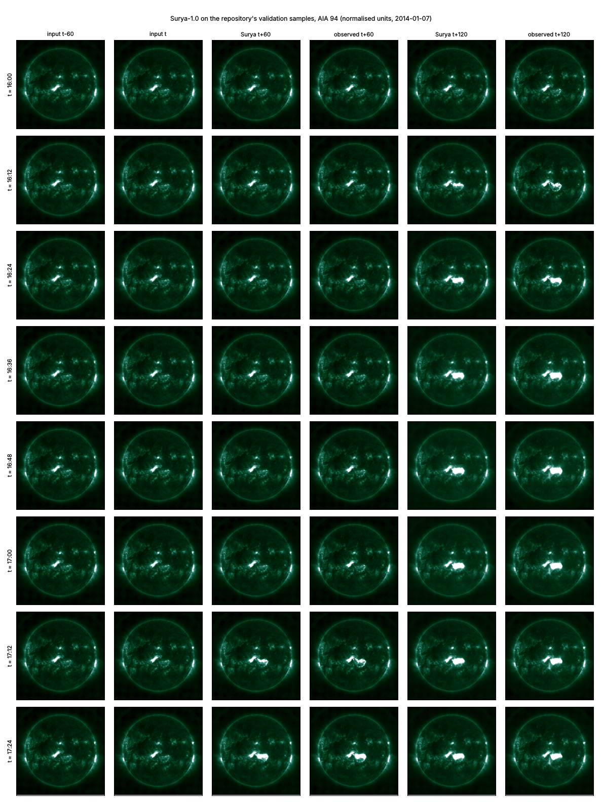

# Reproducing Surya, the NASA–IBM Heliophysics Foundation Model

Xiangsheng (Harry) Bao, University of Sydney, November 2026

---

## 1. Summary

Professor Wang asked me to go to the IBM Research blog post on Surya (https://research.ibm.com/blog/surya-heliophysics-ai-model-sun), click the Citation button for each tool, download the tool, reproduce all results and report how it went. The post has no Citation button, so I followed every tool and paper it links to and recorded the citation each of them asks for. The tools are the Surya code on GitHub, the Surya-1.0 model and four fine-tuned models on Hugging Face, the SuryaBench datasets, and IBM's TerraTorch library. I downloaded all of them and ran what a 4-core CPU machine with 15 GB of memory and no GPU can run.

Pretraining Surya took 128 A100 GPUs and about 257 TB of data, and fine-tuning the downstream models also needs GPUs, so none of the training can be repeated here. What I could do was run the released weights. The main results are these.

The repository's own validation test passes on CPU. It forecasts 8 samples from 7 January 2014 two hours ahead and compares the mean loss with hard-coded reference values. My float32 run gives 0.316689 against a reference of 0.316647, inside the test's tolerance of 1e-4. This is the setting of the paper's Fig. 14, and the forecasts show the same brightening of the active region that produced the X1.2 flare at 18:04 UT that day.

Zero-shot forecasting on 20 initialisation times drawn from the paper's validation period gives a mean 1-hour MSE of 0.195 (95% interval 0.188 to 0.201), against 0.20172 in the paper's Table 9, and 0.214 at 2 hours against 0.22351. Persistence on the same samples is 0.566 at 1 hour against the paper's 0.59868, so my sample is a little easier than the paper's, and the ratio of Surya to persistence is about the same.

For the four fine-tuned models I could only afford small samples, 40 to 70 cases per task. For active-region segmentation and flare forecasting the paper's numbers lie inside my 95% intervals. For the solar wind model they do on the validation period (RMSE 61.7 km/s against 75.92), but not on the 2020–2024 test period, where the model underestimates the speed in 51 of 60 cases and does worse than always predicting the training mean (RMSE 107.1 km/s). For the EUV spectra the paper's numbers fall between my validation sample, where the model does better, and my test sample, where it does somewhat worse. The paper does not say which split its downstream tables use. For flare forecasting the published numbers themselves point to the validation period, and the solar wind results fit that too. That period was also evaluated after every training epoch.

Two things went wrong along the way and are worth knowing about. First, the model gives wrong results on CPU in bfloat16. I traced this to a bug in PyTorch's oneDNN bfloat16 convolution for 16×16, stride-16 convolutions with 26 input channels, which is exactly Surya's patch embedding. Running only that layer in float32 fixes it. Second, the TerraTorch integration that the blog advertises did not exist yet when the blog was published, and it loads weights without checking them. With its default settings the base model runs with 8 attention heads instead of 16 and is 14% worse on the test sample, and the four fine-tuned models load none of the weights that were learned for their tasks. In neither case is there a warning.

One more finding concerns the EUV model. Its patch embedding, the first layer, was never trained and is still the random initialisation, so this model does not use the foundation model's first layer at all (§5.8).

---

## 2. The tools on the blog and their citations

The blog links to the Surya GitHub repository, the nasa-ibm-ai4science organisation on Hugging Face, a SuryaBench collection on Hugging Face, the TerraTorch GitHub repository and documentation, and four arXiv papers (Surya, SuryaBench, SpectFormer and the Long-Short Transformer). Since there is no Citation button, I took the citation from each resource itself. The full record, with the BibTeX copied verbatim and the URL and line it came from, is in `papers/surya_citations/`.

All the Surya resources ask to be cited through the Surya paper, arXiv:2508.14112, but they give three different BibTeX entries. The GitHub README has `roy2025surya` with ten authors and "others". The Hugging Face model card has the 32 authors of arXiv version 1, and its arXiv number is still the placeholder `XXXX.XXXXX`. The arXiv export of version 2 has 33 authors. The only git tag of the code, v1.0.0, has no citation section at all; it was added later. The SuryaBench datasets point to arXiv:2508.14107, which has since been published in *Scientific Data* (13:712, 2026), and each dataset also has its own Hugging Face DOI tied to a specific commit. TerraTorch asks for arXiv:2503.20563. None of these repositories has a CITATION.cff file, and the SuryaBench collection link and the TerraTorch documentation link on the blog no longer work (HTTP 401 and 404).

---

## 3. How Surya works

Surya takes full-disk images from NASA's Solar Dynamics Observatory and forecasts the next image. Each input has 13 channels at 4096 × 4096 pixels: eight extreme-ultraviolet and ultraviolet wavelengths from the AIA instrument (94, 131, 171, 193, 211, 304, 335 and 1600 Å) and five products from the HMI instrument (the line-of-sight magnetic field, the three components of the vector field, and the Doppler velocity). The data are on a 12-minute cadence from 2010 onward. Before training, each channel is put through a signed log transform and standardised, and all losses are reported in these normalised units.

The model receives two frames an hour apart, at t − 60 min and t, and predicts the frame at t + 60 min. It cuts the 26-channel stack (13 channels × 2 times) into 16 × 16 patches with a convolution, which gives 65,536 tokens of width 1,280. The tokens go through two spectral gating blocks, which multiply the Fourier transform of the token grid by learned filters and so mix information across the whole disk cheaply, and then eight long-short attention blocks, which combine attention within small windows with attention to a low-rank projection of all tokens. A linear decoder turns the tokens back into a 13 × 4096 × 4096 image. In all, the model has 366 million parameters. For longer forecasts it is run autoregressively: the forecast is appended to the inputs and the oldest frame dropped. It was pretrained on 2011–2019 data for one-hour forecasts and then tuned on rollouts of up to five hours. Days 15 to 31 of each year were held out as the validation period.

For the downstream tasks the backbone is kept and a small head is added. LoRA adapters are trained inside the backbone for active-region segmentation, flare forecasting and solar wind, while the EUV spectra model in the repository uses a frozen backbone. The heads produce a segmentation mask, a flare probability, a solar wind speed and a 1,343-point EUV spectrum respectively.

---

## 4. What I could and could not run

The machine has 4 CPU cores, 15 GB of memory and no GPU. One forward pass of Surya at full resolution takes 2 to 5 minutes here in float32 and needs 10 to 13 GB of memory, so I evaluated everything one sample at a time. The full-resolution frames for the benchmark are in a public Amazon S3 bucket (no requester-pays, so no cost) at about 0.6 GB each. I checked that a frame from S3 decodes to exactly the same values as the Hugging Face copy, channel by channel, and then used S3 for all inputs. No paid services were used.

Pretraining, rollout tuning, the ablations and the baseline models (AlexNet, ResNet50, UNet, the learned flow) cannot be reproduced: no training scripts or baseline weights are released, and the compute is out of reach. The downstream fine-tuning scripts require CUDA. What can be reproduced is everything that only needs the released weights: the repository's test, zero-shot forecasting, and the four fine-tuned models. Even there, the full evaluation sets are terabytes, so I used small seeded samples and report each number with a bootstrap interval. The paper does not say which split or how many samples its downstream tables use, so these comparisons can show whether the published numbers are plausible, not reproduce them exactly.

---

## 5. Results

### 5.1 The repository's validation test

`tests/test_surya.py` builds the model, loads the weights, forecasts two steps ahead from 8 initialisation times on 7 January 2014 (16:00 to 17:24, every 12 minutes) and checks that the mean loss is within 1e-4 of hard-coded reference values. The 23 data files it needs (15.4 GB) did not fit on my disk at once, so I ran the samples in five groups that share files, downloading each group, scoring it and deleting it. Everything that affects the numbers is the authors' code, imported unchanged.

On a machine without CUDA the test's `torch.autocast(device_type="cuda")` does nothing, so the test runs in float32. In float32 every sample is close to its reference, and the mean passes the test:

| Initialisation time | Reference loss | My loss (float32) | Persistence |
|---|---|---|---|
| 16:00 | 0.248909 | 0.248890 | 0.9735 |
| 16:12 | 0.311660 | 0.311790 | 1.2339 |
| 16:24 | 0.324980 | 0.324885 | 2.2602 |
| 16:36 | 0.321989 | 0.321814 | 3.8066 |
| 16:48 | 0.309087 | 0.309237 | 4.1570 |
| 17:00 | 0.319093 | 0.319034 | 3.7826 |
| 17:12 | 0.360530 | 0.360565 | 3.5537 |
| 17:24 | 0.336930 | 0.337297 | 4.1094 |
| Mean | 0.316647 | 0.316689 | 2.9846 |

The difference in the mean is 4.2e-5, and the largest difference for a single sample is 3.7e-4. The persistence column is my own addition: it uses the last input frame as the forecast. It grows sharply for the later samples because their two-hour targets fall in the X1.2 flare that began at 18:04 UT (peak 18:32, from the NOAA GOES flare list). Surya's forecasts brighten that region two hours ahead, which is what the paper shows in its Fig. 14 (Figure 1 below). Each sample took about 4.5 minutes, and the process peaked at 12.9 GB.

Figure 1. AIA 94 Å for the eight samples of the repository test: the two input frames, Surya's 1-hour and 2-hour forecasts, and the observed frames, in normalised units and averaged to 512 × 512 pixels. The bright region near the centre of the disk in the 2-hour columns is the X1.2 flare.

### 5.2 Why bfloat16 fails on CPU, and the fix

The reference losses were presumably computed on a GPU with bfloat16 autocast, so I also ran the test with CPU bfloat16 autocast. The mean loss was 3.62, worse even than persistence. Comparing the model layer by layer against float32 on one sample showed that the very first layer, the patch-embedding convolution, already had a relative error of about 1, meaning its output was wrong rather than slightly rounded. Forcing layer norm and softmax to float32, which is where CPU and CUDA autocast differ, changed nothing.

A small test with random weights and 64 × 64 inputs reproduces the problem. In PyTorch 2.10 on this Intel Xeon (AVX-512 with AMX), a bfloat16 Conv2d through oneDNN gives a relative error of 1.15 to 1.35 for 16 × 16, stride-16 kernels with 16 or 26 input channels, against 0.003 (the size of bfloat16 rounding) with oneDNN disabled. Kernels with 3, 13 or 32 input channels, and smaller kernels, are fine. Surya's patch embedding has 26 input channels (13 channels × 2 times) and a 16 × 16 kernel, so it falls exactly into the failing case. With only that layer in float32 and the rest in bfloat16, the 1-hour MSE on the test sample is 0.231137 against 0.231124 in float32, and the run is about four times faster. I used float32 for every number in this report. The scripts are in `scripts/Surya/diagnose_cpu_bf16.py`, `bf16_conv_repro.py` and `bf16_conv_shapes.py`.

### 5.3 Zero-shot forecasting (Table 9)

Table 9 of the paper gives the MSE of the released model at lead times from 1 to 12 hours on the validation period (days 15 to 31 of 2011–2019), together with persistence. The paper does not say how many initialisation times it used. I drew 20 times on the full hour, two per year plus two more, from the 3,137 times in the released validation index that have all the frames needed for a two-hour forecast, and scored the 1-hour and 2-hour forecasts. As a check, I first ran the test sample 16:48 through the same code with frames from S3, and it gave exactly the loss of the repository test (difference 0).

| Lead | Surya, my sample (95% interval) | Surya, Table 9 | Persistence, my sample | Persistence, Table 9 |
|---|---|---|---|---|
| 1 hour | 0.1947 (0.1880–0.2015) | 0.20172 | 0.566 (0.520–0.614) | 0.59868 |
| 2 hours | 0.2143 (0.2061–0.2227) | 0.22351 | 0.647 (0.587–0.709) | 0.70594 |

Surya's errors on my sample are 3 to 4 % below the paper's, and persistence is 5 to 8 % below, so my 20 times seem slightly calmer than the paper's set. The ratio of Surya to persistence, 0.34 at 1 hour, is the same as in the paper. I take this as a reproduction of the released model's column of Table 9 within the limits of the sample. The 1-hour to 4-hour columns use intermediate checkpoints that are not released, and the learned-flow baseline has no released weights, so those columns cannot be checked.

### 5.4 How I evaluated the fine-tuned models

None of the four downstream tasks has a script that computes the paper's metric over a dataset (§6), so I wrote one evaluation script per task around the authors' own model-building, LoRA and dataset code, imported unchanged. Each loads the released checkpoint with `strict=True`, scores a seeded sample one image at a time in float32, records every prediction, and reports the metric with a 95% bootstrap interval. The SuryaBench datasets have a training period (2010–2019 from 15 February), a validation period (15–31 January of 2011–2019) and a test period (2020–2024); the EUV data are an exception and end in 2014 (§5.8). The paper does not say which it used for Tables 3 to 6, so I scored a sample from the test period and a smaller one from the validation period and report both. Each script was checked line by line against the upstream code by a separate review before it was run, and the reviews and method notes are in `results/Surya/<task>/`.

### 5.5 Active-region segmentation (Table 3)

The model outputs a probability for each pixel of being inside an active region with a polarity inversion line, and the label is the SuryaBench mask built from HMI magnetograms. I thresholded at 0.5 and computed IoU and Dice for each image. The paper does not say how it averaged, but its pair of numbers (IoU 0.768, Dice 0.853) cannot come from scores pooled over all pixels, because for pooled scores Dice is always 2·IoU/(1 + IoU), which would give 0.869. So I report the mean over images as the main number and the pooled score alongside.

| Sample | IoU, mean over images | Dice, mean over images | IoU, pooled | Dice, pooled |
|---|---|---|---|---|
| Test period, 30 images (6 per year, 2020–2024) | 0.719 (0.645–0.780) | 0.817 (0.744–0.870) | 0.764 (0.728–0.796) | 0.866 (0.842–0.886) |
| Validation period, 10 images (2011–2019) | 0.672 (0.495–0.807) | 0.764 (0.576–0.888) | 0.699 (0.620–0.805) | 0.823 (0.765–0.892) |
| Paper, Table 3 | 0.768 | 0.853 | | |

The paper's values are inside all the intervals. The per-image means are somewhat lower. Part of this comes from a few hard images: one image in each sample has an empty mask, and the 2020 images, near solar minimum, score lowest. Scores rise from 2020 (mean IoU 0.65) to 2023–2024 (0.77) as activity increases. The result does not depend much on the threshold: the per-image IoU of the test sample stays between 0.71 and 0.72 for thresholds from 0.1 to 0.6. The UNet baseline in Table 3 (IoU 0.688) cannot be checked because its weights are not released.

### 5.6 Flare forecasting (Table 4)

The flare model takes the frames at t − 60 min and t and outputs one logit for whether an M-class or larger flare occurs in the next 24 hours. TSS, the true positive rate minus the false positive rate, does not depend on how common flares are in the sample, so I drew equal numbers of flaring and non-flaring times and estimated it directly. HSS and F1 do depend on the flare rate, so I re-weighted them to the rate of the split. The repository has two decision rules: `infer.py` predicts a flare when the sigmoid output exceeds 0.5, and the validation code in `finetune.py` when the raw logit exceeds 0.5. I used the first as the main rule and report the second as well.

| Sample | Hits | False alarms | TSS (`infer.py` rule) | HSS | F1 | TSS (`finetune.py` rule) |
|---|---|---|---|---|---|---|
| Test period, 20 flaring + 20 quiet | 6 of 20 | 0 of 20 | 0.30 (0.10–0.50) | 0.38 | 0.46 | 0.20 (0.05–0.40) |
| Validation period, 10 + 10 | 5 of 10 | 0 of 10 | 0.50 (0.20–0.80) | 0.64 | 0.67 | 0.40 (0.10–0.70) |
| Paper, Table 4 | | | 0.436 | 0.522 | 0.561 | |

The model is conservative: it raised no false alarms in 30 quiet cases and caught half or fewer of the flares. The paper's TSS is inside both intervals, but with 20 to 40 cases the intervals are wide. One more detail suggests which split the paper used. Given TSS, HSS and F1 together, the flare rate of the evaluation set can be worked out, and for Table 4 it comes to 0.106. The validation period has a flare rate of 0.108, while the test period has 0.297, so Table 4 was probably computed on the validation period. The AlexNet and ResNet50 baselines have no released weights.

### 5.7 Solar wind speed (Table 6)

The solar wind model takes the frame at time t and predicts the hourly solar wind speed at L1 four days later. As an end-to-end check I first ran the three validation-period inputs whose predictions are printed in the authors' tutorial notebook, which is a float32 CPU run. My predictions agree with the printed values to within 0.01 km/s. The network was trained on speeds scaled with the minimum and range of the training file (240 and 560 km/s), so I converted its output back to km/s with those constants. For comparison I also scored three simple baselines of my own on the same samples: the speed at time t (4-day persistence), the speed 27 days before the target (27-day recurrence), and the mean speed of the training file, 418.6 km/s.

| Sample | RMSE (km/s) | MAE (km/s) | Mean error (km/s) | RMSE of the training mean |
|---|---|---|---|---|
| Test period, 60 times (12 per year, 2020–2024) | 107.1 (85.3–127.9) | 80.1 (62.5–98.7) | −72.4 | 83.1 |
| Validation period, 10 times (2011–2019) | 61.7 (29.5–89.1) | 45.5 (22.6–73.1) | −33.7 | 76.8 |
| Paper, Table 6 | 75.92 | 58.06 | | |

On the validation sample the paper's RMSE and MAE are inside my intervals, and the predictions follow the observations (correlation 0.75). On the test period they do not. There the model underestimates the speed in 51 of the 60 cases. Its predictions all lie between 291 and 402 km/s, with a mean of 327 km/s, while the observed speeds run from 287 to 593 km/s with a mean of 400 km/s. The correlation is only 0.23, and the RMSE is 24 km/s worse than always predicting the training mean (paired 95% interval 7 to 39 km/s). The errors are largest in 2021 and 2022 (RMSE 139 and 157 km/s). Some 2020–2024 frames on S3 are stored in a compact form in which six AIA channels are quantised, and 13 of my 60 inputs are such frames, but leaving them out does not help (RMSE 111 km/s on the other 47).

There is one way to get closer to the paper on the test period. The repository's code converts predictions with the minimum and range of whatever file it is given, and given the test file (256 and 750 km/s) it gives an RMSE of 84.2 km/s (64.9–101.8), with the paper's value inside the interval. This conversion only stretches the predictions and is not the scale the model was trained on, but it may be how the paper's numbers were produced, and I cannot tell which was used. Either way the predictions on 2020–2024 carry little information about the speed four days later. The validation period, where the model does well, was evaluated by `finetune.py` after every training epoch and may have been used to choose the released checkpoint, so it is not strictly held out.

### 5.8 EUV spectra (Table 5)

The EUV model takes the frame at time t and predicts the irradiance spectrum measured by SDO/EVE (MEGS-A) at the same time, in 1,343 bins from 6.5 to 33.3 nm. MEGS-A stopped working in May 2014, so this dataset is different from the others. The authors' code reads one file whose training period runs from May 2010 to May 2014, with a validation period of 15–28 January 2012 and 2013 and a test period of 15–28 January 2011 and 2014. No code in the repository reads the test period. The targets are normalised as (log10 E + 9)/7.04, and Table 5's MSE and MAE only make sense on that scale. MAPE is not implemented in the repository and the paper gives no formula, so I used the usual definition, in percent, on the same scale. Before the sample I ran the two validation pairs whose results are printed in the tutorial notebook. My run reproduces the printout exactly (MAE 0.003811, RMSE 0.013978, R² 0.966644 against 0.966645). As a baseline of my own I used the mean training spectrum, the same for every time.

| Sample | MSE (×10⁻⁴) | MAE | MAPE (%) | Baseline MSE (×10⁻⁴) | Baseline MAPE (%) |
|---|---|---|---|---|---|
| Test period, 30 times (January 2011 and 2014) | 1.54 (1.20–1.92) | 0.0055 (0.0050–0.0061) | 2.07 (1.39–2.88) | 7.21 | 4.70 |
| Validation period, 20 times (January 2012 and 2013) | 0.83 (0.57–1.13) | 0.0037 (0.0034–0.0041) | 1.07 (0.67–1.62) | 1.54 | 1.56 |
| Paper, Table 5 | 1.26 | 0.0045 | 1.48 | | |

The paper's numbers fall between my two samples. The model does better than Table 5 on the validation sample, where my MSE and MAE are below the paper's and outside its intervals, and somewhat worse on the test sample, where the paper's MSE and MAPE are inside my intervals but my MAE is 23% higher. The model is clearly better than the constant spectrum, by a factor of 4.7 in MSE on the test sample and 1.9 on the validation sample. On the validation period, however, the constant spectrum already reaches a MAPE of 1.47% over all 355 pairs, about the same as Table 5's 1.48% for Surya and better than its 1.68% for AlexNet, so MAPE says little on that period. The largest percentage errors come from a few bins near 32.4–33.2 nm where EVE reports its floor value. Leaving out targets below 0.05, which are 0.04% of the elements, brings the test MAPE down to 1.00%.

I also checked how much of the foundation model the released EUV model uses. The repository's EUV configuration uses one input frame instead of two, so its patch embedding has 13 input channels instead of the foundation model's 26 and cannot be copied from it, and the configuration then freezes it along with the backbone. In the released weights the patch embedding is identical to a fresh PyTorch convolution initialised with seed 42, which is the seed `finetune.py` sets, and its correlation with the foundation model's patch embedding is below 0.001. Only the CLS token, one linear layer and the output layer were trained, 3.4 million of the model's 361 million parameters. So the released EUV model passes a random projection of the images to the frozen foundation backbone. It still does about as well as Table 5 reports, but this is not the LoRA fine-tuning to which the paper credits its downstream results.

### 5.9 TerraTorch

The blog, published on 20 August 2025, says Surya is available "via IBM's TerraTorch library". In the TerraTorch git history the first commit adding Surya is dated 22 August 2025, the first tag containing it is 1.1.rc4 (September 2025), and the first release in which `pip install terratorch[surya]` works is v1.1.1 (14 November 2025). I installed the current release, 1.2.13, with the `surya` extra. It cannot be installed on Python 3.11, although its metadata says Python 3.10 or later, because the torchgeo version it pins needs Python 3.12. On Python 3.12 it installs and registers five Surya backbones. Its Surya code is a copy of the upstream repository.

TerraTorch loads weights with `load_state_dict(..., strict=False)` and ignores the result, so a checkpoint that does not fit is loaded silently. I built each registered model the way TerraTorch does and recorded what actually got loaded. The base model loads completely (159 of 159 tensors). However, TerraTorch's defaults for it are 8 attention heads and a projection rank of 8, while the released `config.yaml` uses 16 and 4. Both settings give weight matrices of the same shape, so the checkpoint loads without complaint, but the attention is computed differently. On the test sample, 2014-01-07 16:48, the 1-hour MSE through TerraTorch is 0.2641 with its defaults and 0.2311 with the `config.yaml` values, which matches the upstream model (0.231124). So a user who loads Surya through TerraTorch with default arguments gets a model that is about 14% worse on this sample, with no warning.

The fine-tuned models fare worse. For flare forecasting, active-region segmentation and solar wind, the checkpoint keys all start with the `base_model.model.` prefix that PEFT adds, which TerraTorch's model does not expect. None of the 202, 199 and 202 checkpoint tensors match, and all 159 tensors of the model built through TerraTorch keep their random initialisation. For the EUV model 157 of 159 tensors load, but the five checkpoint tensors that do not are the CLS token, the linear layer and the output layer, which are exactly the parameters that were fine-tuned. TerraTorch reports none of this. Its Surya task entries are registered as backbones, without the task heads, so they may be meant as starting points for new fine-tuning rather than as the released task models. Still, they download the task checkpoints automatically, and then load nothing that was learned for the task.

---

## 6. Things I noticed in the released materials

These are observations about the released code and documents, checked against the files themselves. Several may have explanations that are not written down, and I would be glad to be corrected.

None of the paper's downstream metrics is computed by the released code. The inference scripts print or plot a few samples; there is no loop that produces IoU and Dice, TSS over a split, or MAPE, and MAPE is not implemented anywhere. The paper also does not say which split or how many samples its Tables 3 to 6 use, so I had to write my own evaluation loops around the authors' model and dataset code and choose the split myself.

The flare configuration asks for LoRA on `q_proj`, `k_proj`, `v_proj`, `out_proj`, `fc1` and `fc2`, but Surya's attention layers are called `qkv` and `proj`, so the adapters only attach to the two MLP layers. The released weights were trained this way, so this does not affect my evaluation, but it is not what the configuration suggests.

The solar wind dataset class rescales the wind speed with the minimum and range of whichever CSV file it is given. The model was trained on the training file's scale (240 to 800 km/s), but `infer.py`, and the validation step in `finetune.py`, build the dataset on other files and therefore convert predictions back to km/s with different constants. I used the training constants and report the other conversion separately.

The flare, wind and EUV dataset classes take the label from the index they were asked for, while the image loader they inherit from silently moves to the next index if a file fails to load. A load failure would therefore pair one time's images with another time's label. My scripts stop instead.

The repository's validation test only runs in bfloat16 on CUDA. On a CPU it runs in float32, which is fine, but anyone who tries bfloat16 on CPU hits the convolution bug in §5.2.

The repository's EUV configuration trains only the CLS token and the output layers on a frozen backbone, with no LoRA, and with one input frame its patch embedding cannot be taken from the foundation model. The released EUV weights show exactly this: the patch embedding is the random initialisation (§5.8). The EUV dataset card on Hugging Face describes a test period of 15–31 January, but the file the code reads stops at 28 January.

A few numbers in the paper do not agree with each other. The conclusion gives EUV MAE values of 0.0043, 0.0065 and 0.0256 for Surya, AlexNet and ResNet50, while Table 5 gives 0.0045114677, 0.0061858603 and 0.0529725812. In Table 6 the RMSE of 75.92 km/s and the MSE of 5,698.62 km²/s² cannot both be computed over the same set in the usual way, since the square root of 5,698.62 is 75.49. The citation entries for the paper also differ between the GitHub README, the Hugging Face card and arXiv (§2).
